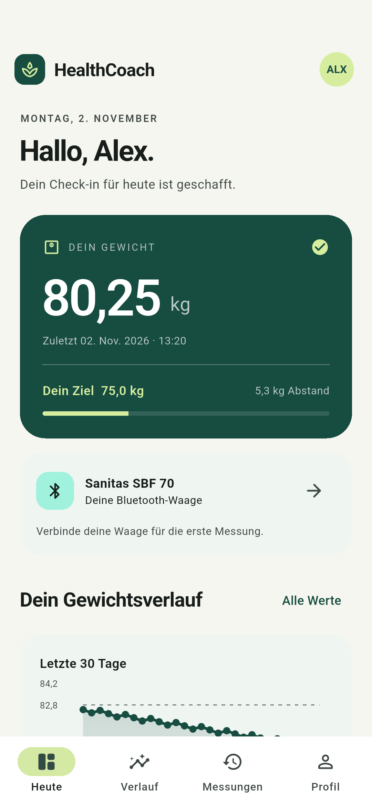
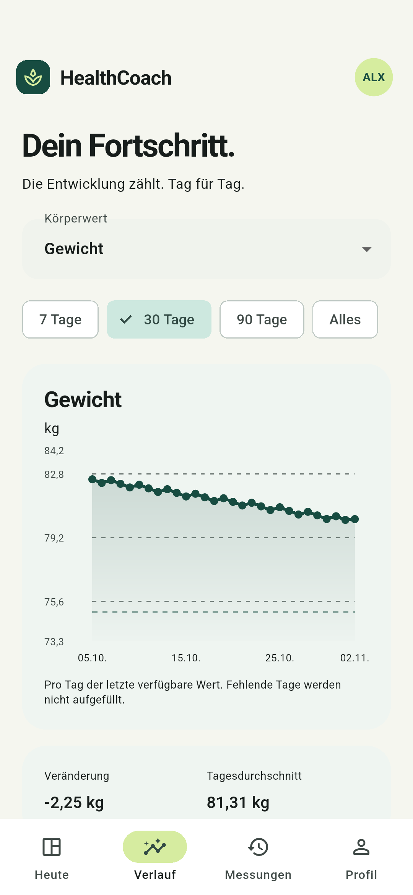

# HealthCoach

Eine persönliche, lokale Android-App für die **Sanitas SBF 70 / SBF 70 S-A**.
Flutter-Oberfläche auf Deutsch, direkte Bluetooth-LE-Verbindung, Zielgewicht und
Verläufe für Gewicht und Körperanalyse. Entwickelt für VS Code.

<p>
  
  
</p>

*Ansichten aus dem Android-Emulator, ausschließlich synthetische Testdaten.*

## Funktionen

- Profile mit individuellen Zielen, getrennten Messungen und Waagenzuordnung.
- Tagesübersicht, Zielabstand und Gewichtsdiagramm.
- Diagramme für Gewicht, BMI, Körperfett, Körperwasser, Muskeln, Knochenmasse,
  BMR (Grundumsatz), AMR (Aktivitätsumsatz) und elektrische Impedanz.
- 7/30/90 Tage oder gesamter Verlauf; letzter verfügbarer Wert je Kalendertag.
- Bluetooth-Suche, Profilprüfung/-anlage, Uhrzeitsynchronisierung,
  Live-Anzeige und Abruf gespeicherter Messungen seit Einrichtung des App-Profils.
- Wiederverbindung beim Öffnen der App (abschaltbar). Keine Hintergrundsuche.
- Manuelle Messungen, optionale Körperwerte und Notizen, Löschung mit Bestätigung.
- SQLite auf dem Handy, JSON-Sicherung/Wiederherstellung, CSV-Export.
- Hell-/Dunkelmodus, Bluetooth-Diagnoseexport, eigene Android-App-Identität.

**Stand:** Die Bluetooth-Anbindung ist implementiert und mit synthetischen
Protokollpaketen getestet. Ein Ende-zu-Ende-Test mit der konkreten SBF 70 S-A
und dem Samsung A17 steht noch aus. Die App enthält keine vorgetäuschten
Messungen. Screenshots und Integrationstests verwenden ausdrücklich Testdaten.
Die BMR-/AMR-/BMI-Byteinterpretation muss beim Hardwaretest mit dem Waagendisplay
verglichen werden. Andere Waagenmodelle werden nicht als kompatibel behauptet.

## Installieren und verwenden

Voraussetzung: Android **8.0 oder neuer**. Für die Waage wird Bluetooth Low Energy
benötigt. Die APK enthält ARM32, ARM64 und x86-64. Eine Unterstützung jedes
Handymodells ist ohne Gerätetests nicht garantiert.

1. Die signierte `healthcoach-1.0.0.apk` aus dem GitHub-Release herunterladen.
2. Auf dem Android-Handy öffnen und die Installation aus dieser Quelle erlauben.
3. Profil anlegen: Name, Waagenkürzel, Geburtsdatum, Größe, Geschlecht,
   Aktivitätsniveau und Zielgewicht. Diese Angaben gehen an die Waage, nicht an
   einen Server.
4. Falls bereits ein Waagenprofil existiert: dessen Kürzel (bis drei Zeichen),
   Geburtstag und Geschlecht verwenden. Identitätskonflikte werden nicht überschrieben.
5. Bluetooth einschalten, die Sanitas-App vollständig schließen, die Waage kurz
   antippen und in HealthCoach auf die Waagenkarte → **Waage suchen** tippen.
6. Die SBF 70 auswählen und die Android-Bluetooth-Freigabe erteilen. Auf älteren
   Android-Versionen erfordert BLE-Suche die Standortfreigabe und aktivierten Standort.
7. Bei „Bereit“ barfuß aufsteigen und warten, bis die vollständige Messung gespeichert ist.

Danach: App öffnen, Waage aktivieren und wiegen. Die App sucht beim Öffnen bis zu
25 Sekunden nach der gespeicherten Waage. Bei Bedarf die Suche erneut starten.
Bereits lokal gespeicherte Daten sind auch ohne Bluetooth verfügbar. Die Waage
darf nicht gleichzeitig von der Hersteller-App belegt sein.

Wird außerhalb der App gewogen, können dem passenden Waagenprofil zugeordnete,
noch gespeicherte Messungen beim nächsten Verbinden nachgeladen werden. Unbekannte
Waagenmessungen werden nicht automatisch einer Person zugeordnet. Vor dem Start
des App-Profils entstandene Werte werden nicht importiert.

Fehlende Körperwerte erscheinen als „nicht verfügbar“. Bei manuellen Einträgen
wird nur der BMI aus dem Gewicht und der zum Eintragszeitpunkt gespeicherten Größe
berechnet; sonstige Körperwerte werden nicht erfunden. BMR und AMR sind die
Schätzwerte der Waage und keine erfasste Nahrungsaufnahme.

## Daten und Sicherung

Kein Konto, keine Analyse-/Werbedienste, kein Backend. Die Haupt-App fordert keine
Internet-Berechtigung an. Android-Cloudsicherung und automatische
Geräteübertragung sind deaktiviert. Daten liegen im privaten App-Verzeichnis.
**Vor Handywechsel oder Deinstallation eine JSON-Sicherung exportieren.**
JSON- und CSV-Exporte sind unverschlüsselte Dateien am selbst gewählten Speicherort.
Der Diagnoseexport enthält Rohdaten der aktuellen Bluetooth-Sitzung und wird nur
auf ausdrücklichen Tastendruck gespeichert.

Wiederherstellen ergänzt fehlende Einträge in einer Transaktion. Vorhandene
Profile und Messungen bleiben erhalten. Importierte neue Profile müssen ihre
Waage erneut zuordnen. Lokal gelöschte Messungen werden durch erneutes
Synchronisieren nicht wieder angelegt. Die App löscht keine Benutzer oder
gespeicherten Messungen auf der Waage.

## In VS Code entwickeln

Getestete Umgebung: Flutter **3.47.0**, Dart **3.13**, JDK **17**, Android SDK
Platform 36 und NDK 28.2.13676358. Ältere SDK-Plattformen werden für die festgelegten
Plugin-Versionen beim Build zusätzlich benötigt. Flutter kann sie über Gradle
installieren, wenn die SDK-Lizenzen akzeptiert sind.

```powershell
git clone https://github.com/Florre1/healtcoach.git
cd healtcoach
code .
flutter pub get
flutter doctor
flutter devices
flutter run
```

Die Dart-/Flutter-Erweiterungen sind in `.vscode/extensions.json` empfohlen.
Im VS-Code-Gerätewähler ein Android-Handy oder einen Emulator auswählen und F5
drücken. Ein echtes Handy benötigt für diesen Entwicklungsweg USB-Debugging;
für die gewöhnliche APK-Installation ist es nicht notwendig.

```powershell
flutter analyze
flutter test
flutter build apk --debug
# Persönliche Release-Signatur einmalig einrichten (Windows / PowerShell 7):
.\tool\setup-signing.ps1
flutter build apk --release
```

Release-Ausgabe: `build/app/outputs/flutter-apk/app-release.apk`.
Die private Signatur liegt außerhalb des Repositories unter
`%USERPROFILE%/.android/healthcoach-signing/`; Kennwörter/Pfad liegen in der
ignorierten Datei `android/key.properties`. **Beides privat sichern**: spätere
App-Updates müssen mit demselben Schlüssel signiert werden. Schlüssel werden nie
automatisch ersetzt. Ohne Schlüssel erzeugt Gradle keine signierte Release-APK.
CI baut eine separate Debug-APK, die die persönlich signierte App nicht ersetzen kann.

BLE- und Berechtigungspakete sind bewusst festgelegt: neuere Versionen hatten
in dieser Umgebung eine inkonsistente Android-37-SDK-Abhängigkeit. Updates erst
nach Build- und Hardwareprüfung übernehmen.
Der Android-Build hebt für `reactive_ble_mobile` 5.5.0 das Compile-SDK von 33 auf
36 an, damit es zu Flutters AndroidX-Abhängigkeiten passt. Kotlin-Inkrementalität
ist deaktiviert, damit Projekt und Pub-Cache auf unterschiedlichen Windows-Laufwerken
liegen können.

## Tests

`flutter test` prüft Paketdekodierung, Einheiten, Zeitstempel-Flag,
Benutzerabgleich, fehlende/fremde/fragmentierte Daten, Duplikate, Profiltrennung,
Sicherung, Wiederherstellung und Tagesaggregation. Testpakete sind synthetisch.

Auf einem laufenden Android-Emulator:

```powershell
flutter drive --driver=test_driver/integration_test.dart --target=integration_test/app_test.dart -d emulator-5554
```

Der Integrationstest nutzt ausschließlich `healthcoach-integration.db`, führt
einen manuellen Eintrag aus, prüft Diagramme/Profiltrennung/Persistenz und speichert
Screenshots unter `artifacts/screenshots/`. Die eigentliche App-Datenbank wird
dabei nicht gelöscht oder mit Testdaten befüllt.

Für den realen Hardwaretest siehe [docs/HARDWARE_TEST.md](docs/HARDWARE_TEST.md).

## Aufbau

```text
lib/domain/           Profile, Messwerte und Tagesaggregation
lib/data/             SQLite und transaktionale Sicherungen
lib/bluetooth/        Reines SBF70-Protokoll + Android-BLE-Transport
lib/ui/               Übersicht, Diagramme, Formulare, Historie, Einstellungen
lib/app_controller.dart  Profilwechsel und Anwendungsabläufe
```

Alle Messungen haben eine Profil-ID und eine stabile Kennung. Ein späterer
Serverabgleich kann an der Repository-Schicht ergänzt werden; derzeit ist kein
Cloud-Dienst konfiguriert. Ein iPhone-Build ist nicht enthalten.

## Lizenz

GPL-3.0-or-later, siehe [LICENSE](LICENSE). Die Bluetooth-Implementierung basiert
auf den veröffentlichten Erkenntnissen und der GPL-Referenz von openScale.
Details: [THIRD_PARTY_NOTICES.md](THIRD_PARTY_NOTICES.md). Unabhängiges Projekt,
keine offizielle Sanitas-/Beurer-App.
